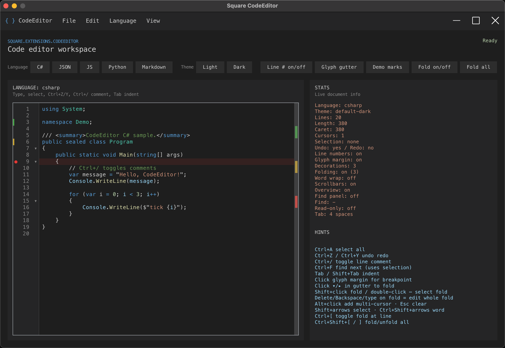

# Square

Square 是一个纯 C#、编译优先、NativeAOT 友好的实验性跨平台桌面 UI 框架。

它借鉴 Vue、HTML 与 CSS 的开发体验，但不是浏览器，也不引入 Vue 运行时或 JavaScript 引擎。`.sqv` / `.sqx` 模板会在编译期由 Roslyn Source Generator 生成普通 C# 组件。

> 项目仍处于早期开发阶段，API 与模板语法可能调整。目前主要验证 Windows / Win32 与 Linux / X11 桌面宿主。

## 0.2.0 性能优化

- 优化分词缓存热路径：按需剪枝、二分前驱查询、复用跨行状态，已缓存读取保持零托管分配。
- 优化大文本回跳：固定检查点预算内保留全局恢复点与目标附近密集点，减少跨区跳转和编辑失效后的重新分词。
- 继续降低布局、CSS 动画、绘制与局部失效路径的 CPU 和分配开销，完善性能对比与回归测试。

百万行混合 C# 文本测试中，相比前阶段优化版，回跳至第 8,192 行的真实 TextMate 分词从 **1,727.7 ms 降至 434.2 ms**，重扫行数由 8,192 降至 2,048；已缓存读取保持零托管分配。这是指定轨迹的分词缓存测量，不是整帧或任意访问模式的保证。环境、采样及复现方法见[完整性能报告](tools/Square.TokenizationBench/CHECKPOINT-RESULTS.md)。

版本改动与平台边界见 [0.2.0 发布说明](docs/releases/0.2.0.md)。

## 截图




## 示例

`Main.sqv`：

```vue
<template>
  <View class="page">
    <Text class="title">Hello {{ Name.Value }}</Text>

    <Input :value="Name" @input="OnNameChanged" />

    <Button ref="SaveButton" @click="OnSave">
      Save
    </Button>

    <Text v-if="Saved.Value">Saved</Text>
  </View>
</template>

<script lang="csharp">
  public ObservableValue<string> Name = new("Square");
  public ObservableValue<bool> Saved = new(false);

  private void OnNameChanged(Event e)
  {
      Name.Value = ((Input)e.Target!).Value;
  }

  private void OnSave()
  {
      Saved.Value = true;
  }
</script>

<style>
  .page {
      display: flex;
      flex-direction: column;
      gap: 12px;
      padding: 16px;
  }

  .title {
      font-size: 20px;
  }
</style>
```

`Program.cs`：

```csharp
using Square.Hosting;

var window = new AppWindow("My App", 800, 600);
window.Load(new Main());

new DesktopApplication(window).Run();
```

## 创建独立应用

[`Wuldas.Square.Templates` 0.2.0](https://www.nuget.org/packages/Wuldas.Square.Templates/0.2.0) 已发布到 NuGet.org。安装 .NET 10 SDK 后，无需克隆仓库或配置本地包源：

```bash
dotnet new install Wuldas.Square.Templates@0.2.0
dotnet new square -n MyApp
dotnet run --project MyApp
```

也可生成桌面与 Android 共用的应用，或添加组件：

```bash
dotnet new square -n MyMobileApp --platforms desktop,android --markup sqx
dotnet new square-component -n UserCard -o MyApp/Components --namespace MyApp.Components
```

默认使用 SQV + Software，依赖直接从 NuGet.org 还原；通过共享 `SquareProgram.CreateWindow()` 复用桌面与可选 Android 的应用初始化。平台要求、模板选项和框架开发者的本地打包流程见[入门指南](docs/Getting-Started.md)。

## 运行示例

```bash
dotnet restore Square.slnx
dotnet build Square.slnx
dotnet run --project samples/Square.Sample.Vue/Square.Sample.Vue.csproj
```

静态 HTML/CSS 外壳与 SQX/SQV 局部挂载示例（可选包默认不启用）：

```powershell
dotnet run --project samples/Square.Sample/Square.Sample.csproj -c Release -p:SquareSampleUseNativeHtml=true -- --backend Software --html-mount-demo
```

用 `--html-file <path>` 指定自定义外壳；组件挂载到 `#sqx-root` / `#sqv-root`，卸载永久释放绑定与生成样式，再挂载须新实例。完整 API 和文件资源边界见 [本地静态 HTML 与组件挂载](docs/Web-Hosting.md#8-本地静态-html-外壳与编译组件挂载)。


Debug 模式下可使用 `dotnet watch` 热更新普通 C#、`.sqx` / `.sqv` 模板和组件 `<style>`：

```bash
dotnet watch --project samples/Square.Sample.Vue/Square.Sample.Vue.csproj
```

模板或组件样式变化时，Square 复用顶层生成组件实例并重建其后代，因此顶层 C# 字段和响应式状态会保留；窗口 `Content` / 自定义标题栏需要以生成组件作为顶层根。根组件及后代会重新执行 unload/detach/attach/load 生命周期，生命周期代码应支持重复挂载。后代控件的局部状态、焦点、滚动位置和选择区不保证保留。组件或文件重命名、删除成员及部分 `ref` 结构变化仍可能要求重启。

主示例可选择 CPU Skia 后端：

```bash
dotnet run --project samples/Square.Sample/Square.Sample.csproj -- --backend Skia
```

Windows 主示例也可选择原生 Direct2D HWND 后端：

```powershell
dotnet run --project samples/Square.Sample/Square.Sample.csproj `
  -p:SquareTargetPlatform=Win32 `
  -p:SquareSampleUseDirect2D=true `
  -- --backend Direct2D
```

运行 RichText 示例：

```bash
dotnet run --project samples/Square.Sample.RichText/Square.Sample.RichText.csproj
```

运行测试：

```bash
dotnet test Square.slnx
```

## 布局动画性能对比

[对比示例](samples/Square.Sample.PerfComparison)包含 Square Software / Direct2D（JIT 与 NativeAOT）、Avalonia（JIT 与 NativeAOT）、Electron 和 Flutter。各目标使用 900×1240 客户区、3 组各 240 个方块，分别运行 transform、opacity、width 动画，6 秒线性循环，目标更新频率为 60 FPS。width 组改变真实宽度并触发行重排，不用缩放代替布局。

### 复现

需要 Windows x64、PowerShell 7、.NET 10 SDK、Node.js/npm、Flutter Windows 桌面 SDK，以及 Visual Studio C++ / Windows SDK 工具链（用于 NativeAOT 和 Flutter）。将 `flutter` 加入 PATH，或通过 `-FlutterCommand` 指定 `flutter.bat` 的完整路径。

```powershell
pwsh -NoProfile -File samples/Square.Sample.PerfComparison/Run-Comparison.ps1 `
  -Seconds 30 -WarmupSeconds 5
```

脚本先构建所有 Release 发布物，再按固定顺序逐个运行；上述命令每个目标预热 5 秒、测量 30 秒，目标之间间隔 2 秒。测量期间不构建、不挂接 DevTools。Square Direct2D 必须使用硬件设备；Square 使用 Auto 脏区渲染，各框架原生的布局与合成优化保持启用。Flutter 按绝对 60 Hz 截止点驱动动画，避免原生时钟高于 60 Hz 时增加负载；实际产出帧率仍由下面的计数定义决定。

默认将逐目标 JSON、stdout/stderr 和汇总 `results.json` 写入 `artifacts/perf-comparison-时间戳/`。可通过 `-OutputDirectory` 指定目录，`-Seconds` / `-WarmupSeconds` 调整时长，已有发布物时可用 `-SkipBuild`。发布目录由脚本管理，重新构建时会清空对应的 .NET 输出目录，避免旧文件虚增体积。

Avalonia 的 JIT / NativeAOT 构建共用同一界面、动画和采样逻辑。NativeAOT 按 [Avalonia 11.x 的要求](https://github.com/AvaloniaUI/avalonia-docs/blob/main/docs/deployment/native-aot.md)设置 `BuiltInComInteropSupport=false`，不启用基于内建 COM 互操作的辅助功能路径。

### 统计口径

- **CPU**：测量区间的进程 CPU 时间 / 实际经过秒数 × 100%；100% 表示占满一个逻辑处理器，不是任务管理器的整机百分比。Electron 汇总浏览器、渲染、GPU 和 utility 等所属进程；进程在两次采样之间退出时，最后一次观察之后的 CPU 时间可能漏计。JSON 另存整机折算值和每帧 CPU 毫秒数。
- **内存**：约每秒采样一次，分别记录私有提交内存（Private Bytes）和驻留工作集（Working Set）的均值、观察到的峰值，单位为 MiB；不含独立 GPU 显存。Electron 为多进程合计，工作集可能重复计入共享页。
- **FPS**：实际帧计数 / 实际测量秒数，不写死为 60。Square 计渲染提交，Avalonia / Electron 计动画帧回调，Flutter 计区间内栅格完成的引擎 `FrameTiming`。这些都不是显示器物理扫描输出计数；原始 JSON 的 `fpsDefinition` 保留各目标的具体定义，不应据此比较细微的呈现帧率差异。
- **发布体积**：未压缩、可运行的 Windows x64 发布目录总大小，包含运行时、动态库和资源，排除 `.pdb` / `.dbg` 调试符号；不是仅比较 EXE。JIT 目标均为 self-contained；Square 的两个后端共用同一份对应发布物。JSON 同时保留入口 EXE 字节数。

### 本机实测（2026-10-19）

Square 基于 `08da487`。Windows 11 Pro 10.0.26300；Intel Core i5-12400F（12 个逻辑处理器）；NVIDIA GeForce GTX 1660 SUPER，2560×1440 / 60 Hz。使用 .NET SDK 10.0.303、Avalonia 11.3.12、Electron 44.7.2、Flutter 3.47.7 stable。全部为重新构建的 Release / Windows x64 发布物，单轮串行运行，预热 5 秒，请求测量 30 秒；计算采用 JSON 中记录的实际区间。

**同步配置：本次为恢复垂直同步及 CPU 优化后的复测。** Win32 保持 `VSync=true`，Direct2D 保留 `RETAIN_CONTENTS`，不启用 `IMMEDIATELY`；不能将其与此前关闭 VSync 的快照视为相同条件。

| 目标 | CPU（单核=100%） | 实测 FPS | 私有内存均值（MiB） | 工作集均值（MiB） | 发布体积（MiB） |
|---|---:|---:|---:|---:|---:|
| Square Software · JIT | 44.23% | 60.01 | 58.68 | 107.98 | 99.93 |
| Square Direct2D · JIT | 22.17% | 60.01 | 111.41 | 147.51 | 99.93 |
| Square Software · NativeAOT | 48.14% | 60.01 | 51.48 | 80.58 | 9.40 |
| Square Direct2D · NativeAOT | 26.48% | 60.01 | 100.78 | 106.72 | 9.40 |
| Avalonia · JIT | 26.81% | 59.97 | 124.29 | 149.10 | 102.67 |
| Avalonia · NativeAOT | 29.20% | 59.97 | 115.45 | 115.26 | 34.88 |
| Electron · packaged | 93.67% | 59.97 | 267.35 | 416.74 | 366.89 |
| Flutter · Release | 37.13% | 59.83 | 176.47 | 125.95 | 23.37 |

[原始汇总数据](samples/Square.Sample.PerfComparison/results.json)包含实际时长、帧数、内存峰值、CPU 每帧成本、发布字节数、运行环境和逐目标 FPS 定义。比较 CPU 时应同时看实测 FPS。单轮结果受后台负载、执行顺序、JIT 和温度影响，不代表统计上成立的跨框架排名。

## Android Experimental

Android 首期使用 .NET 10 for Android、单 Activity 和单 `SquareView`，通过 `ApplicationSession` 由 Activity/Looper/Choreographer 驱动。默认路径为 Software BGRA bitmap 到 Android `ARGB_8888` bitmap；也可通过 Activity extra 选择 `AndroidCanvas`、`AndroidSkia` 或 `Vulkan` 直绘路径。Android 不引入 MAUI、原生 View/Compose 控件树或桌面窗口操作。

```bash
dotnet workload restore Square.Android.slnx
dotnet restore Square.Android.slnx -p:SquareTargetPlatform=Android
dotnet build Square.Android.slnx -c Debug -p:SquareTargetPlatform=Android
dotnet publish samples/Square.Sample.Android/Square.Sample.Android.csproj \
  -c Release -f net10.0-android -r android-arm64 --self-contained false \
  -p:SquareTargetPlatform=Android -p:PublishAot=false -p:TrimMode=full
```

```bash
adb shell am start -n <package>/<activity> --es backend AndroidCanvas
adb shell am start -n <package>/<activity> --es backend AndroidSkia
adb shell am start -n <package>/<activity> --es backend Vulkan
```

Release 的 x86_64 Android 门禁使用 trimming + profiled Mono AOT：`PublishAot=false`、`RunAOTCompilation=true`、`AndroidEnableProfiledAot=true`。当前 arm64 APK/AAB 产物使用 Release trimming；`PublishAot=true` 仍会触发官方 XA1040 实验性限制，不作为生产支持声明。

当前 Android 支持等级为 Experimental：代码、x86_64 emulator 的 IME/像素/性能/生命周期/虚拟 accessibility tree smoke、Canvas/Skia/Vulkan 路径以及 APK/AAB 构建已落地；arm64 真机验证、稳定版多设备门禁和官方 NativeAOT 仍未完成。详细边界与验收矩阵见 [Android 平台 TODO](docs/Android-Platform-TODO.md)。

## NativeAOT 发布

Hot Reload 仅用于框架依赖运行时的 Debug 构建，不适用于 Release、trimming 或 NativeAOT 发布。

Windows x64：

```bash
dotnet publish samples/Square.Sample.Vue/Square.Sample.Vue.csproj \
  -c Release \
  -r win-x64 \
  -p:SquareSamplePublishAot=true \
  --self-contained true
```

Linux x64 / X11：

```bash
dotnet publish samples/Square.Sample.Vue/Square.Sample.Vue.csproj \
  -c Release \
  -r linux-x64 \
  -p:SquareSamplePublishAot=true \
  -p:SquareTargetPlatform=X11 \
  --self-contained true
```

## 文档

- [入门指南](docs/Getting-Started.md)
- [SQV / Vue 模板语法](docs/vue-plan.md)
- [SQX 原生语法](docs/Sqx-Spec.md)
- [总体架构](docs/Architecture.md)
- [API 参考](docs/API-Reference.md)
- [CSS 规范](docs/CSS-Spec.md)
- [布局](docs/Layout.md)
- [渲染](docs/Rendering.md)
- [DevTools 调试服务](docs/DevTools.md)
- [Web Server 与静态 HTML](docs/Web-Hosting.md)
- [开发路线](docs/Roadmap.md)

## 项目状态

Square 适合框架设计验证、实验和贡献开发，暂不建议用于生产项目。

首个版本 `0.1.0` 已发布，包含 20 个 NuGet 包，入口为[核心包](https://www.nuget.org/packages/Wuldas.Square/0.1.0)与[模板包](https://www.nuget.org/packages/Wuldas.Square.Templates/0.1.0)。当前版本为 `0.2.0`，包含 22 个框架及模板包；源码默认版本与发布标签保持一致。`docs/` 文档头部的版本号是各文档的独立修订号，不代表包版本。

贡献流程见 [`CONTRIBUTING.md`](CONTRIBUTING.md)。安全问题请按 [`SECURITY.md`](SECURITY.md) 私下报告。

## NuGet 发布

NuGet 包 ID 统一为 `Wuldas.Square` / `Wuldas.Square.*`，避免与已存在的 Square 支付 SDK 冲突。程序集、C# 命名空间、源码项目名及 `dotnet new square` 命令不变。

`v0.1.0` 已通过 CI、Android 和[正式发布工作流](https://github.com/wuldas/Square/actions/runs/33955548922)，并完成全新缓存下从 NuGet.org 安装模板、生成项目和构建验证。以下流程用于后续版本发布。

`.github/workflows/publish.yml` 使用 NuGet Trusted Publishing，无需长期 API Key。策略 `SquarePublish` 绑定 `wuldas/Square`、工作流文件名 `publish.yml`、包所有者 `wuldas`，允许发布新包及新版本；Environment 留空。包匹配范围为以下两行：

```text
Wuldas.Square
Wuldas.Square.*
```

先在 GitHub Actions 手动运行 **Publish NuGet**，输入版本号。这只构建、验证并上传工作流产物，不向 NuGet.org 发布。本地也可以验证（需要 .NET 10、Android workload 与 JDK 17）：

```powershell
pwsh -File tools/Pack-Release.ps1 -Version 0.2.0 -OutputDirectory artifacts/packages
```

输出目录必须为空。脚本打包全部 22 个框架及模板包，检查内部依赖闭环和版本一致性，并让模板中的包引用使用发布版本；不会修改模板源码。正式发布前应确认该提交的 CI 和 Android 工作流通过，并确认账号有权使用所有目标包 ID。

推送 `v` 开头的版本标签会正式发布。`v0.1.0` 已存在，不要重建或移动；以下以 `0.2.0` 演示发布，版本须与手动验证时一致，仅在准备好正式发布时执行：

```bash
git tag -a v0.2.0 -m "Release Wuldas.Square 0.2.0"
git push origin v0.2.0
```

标签去掉 `v` 后成为统一包版本，也支持 `v0.2.0-preview.1`。发布任务仅在标签推送时运行，通过 `NuGet/login` 获取短期凭据后上传 `.nupkg` 及配套符号包。相同版本已存在时跳过；已发布版本不可覆盖，修复应发布新版本。工作流不会在普通 `main` 推送或手动验证时发布。


## License

MIT
